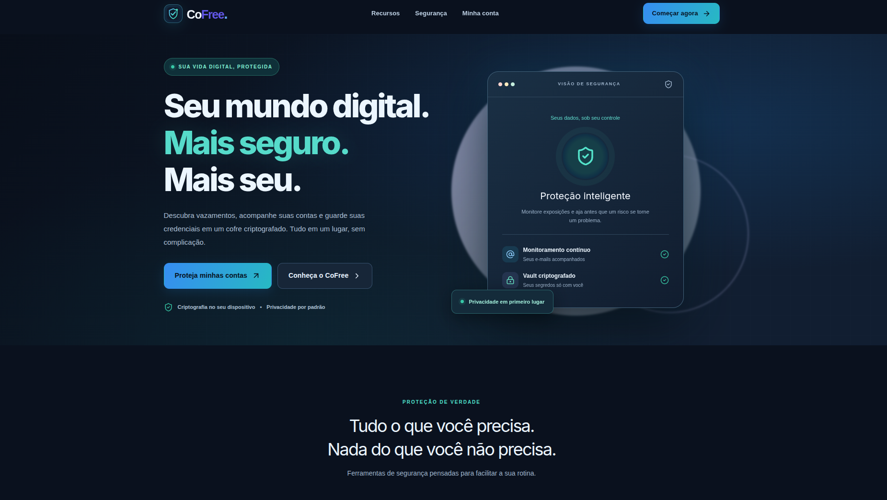
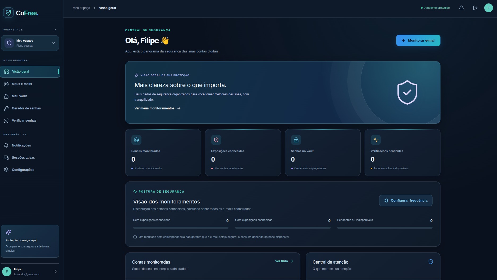
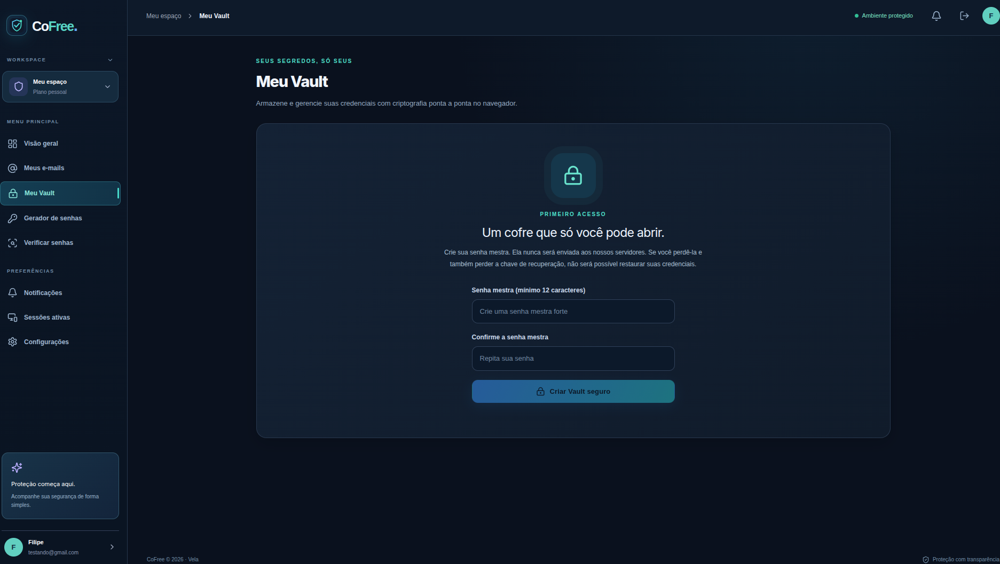
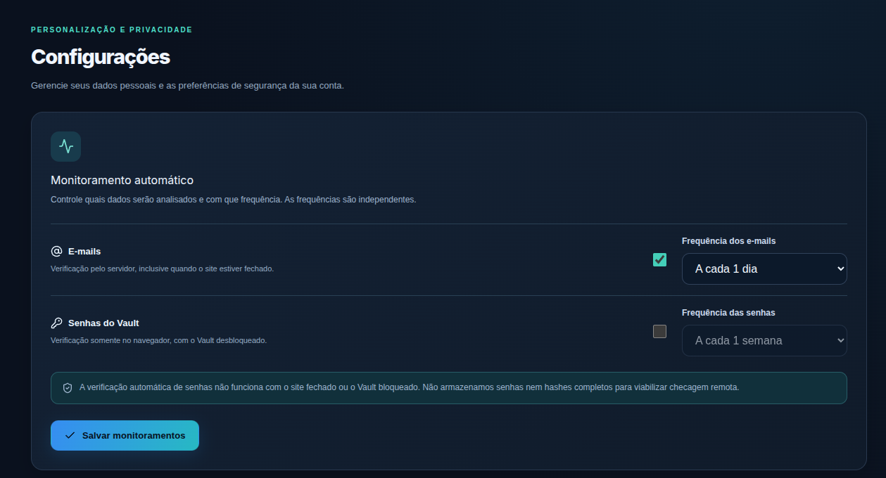
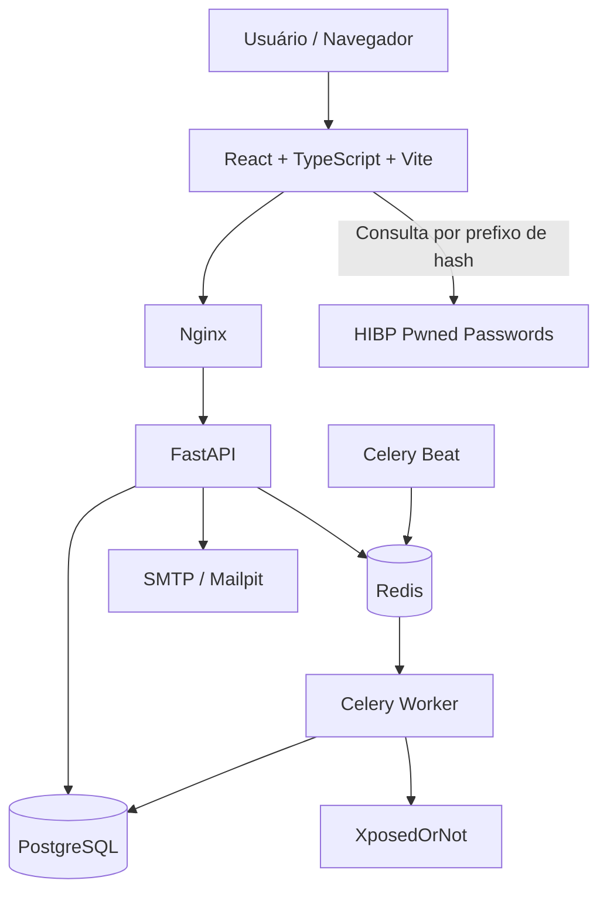
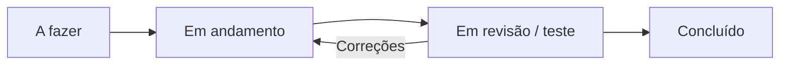

<div align="center">

# 🛡️ CoFree

### Seu mundo digital. Mais seguro. Mais seu.

**Uma plataforma de segurança digital para acompanhar exposições de e-mails, verificar senhas comprometidas e proteger credenciais em um Vault criptografado.**

[](https://react.dev/)
[](https://www.typescriptlang.org/)
[](https://fastapi.tiangolo.com/)
[](https://www.postgresql.org/)
[](https://docs.docker.com/compose/)

**Projeto acadêmico de Engenharia de Software · Vela · UNIFAVIP Wyden**

[Sobre o projeto](#-sobre-o-projeto) · [Funcionalidades](#-funcionalidades) · [Demonstração](#-demonstração-visual) · [Instalação](#-executando-localmente) · [Arquitetura](#-arquitetura) · [Segurança](#-segurança-e-privacidade)

</div>

---

## 💡 Sobre o projeto

Muitas pessoas utilizam diversas contas digitais, mas não sabem **quando um e-mail aparece em um vazamento conhecido**, se uma senha já foi comprometida ou quais medidas tomar após uma exposição.

O **CoFree** foi desenvolvido para aproximar a segurança digital do dia a dia: reunir informações relevantes, organizar o acompanhamento das contas e oferecer ferramentas de prevenção em uma interface clara, moderna e **totalmente em português**.

A solução é um projeto da **Vela**, fábrica fictícia de soluções digitais criada no contexto acadêmico. Seu desenvolvimento aplica conceitos de **Engenharia de Software**, desde o levantamento de requisitos e a definição do MVP até a arquitetura, os testes, o Kanban e a manutenção.

> [!IMPORTANT]
> O CoFree é um **projeto acadêmico em desenvolvimento**. Ainda não é um gerenciador de senhas auditado ou homologado para uso em produção. Para demonstrações, prefira credenciais fictícias e e-mails próprios ou autorizados.

## ✨ Funcionalidades

| Área | O que o CoFree oferece |
|:--|:--|
| **Monitoramento de e-mails** | Cadastro de endereços, consultas a vazamentos conhecidos, histórico e status de acompanhamento. |
| **Verificador de senhas** | Verificação manual de senhas comprometidas usando o serviço gratuito Pwned Passwords com *k-anonymity*. |
| **Vault criptografado** | Armazenamento de credenciais com criptografia AES-256-GCM no navegador e senha mestra derivada localmente. |
| **Monitoramento automático** | Ativação e personalização de frequências de 1 hora, 1 dia, 1 semana ou 1 mês. |
| **Gerador de senhas** | Geração de senhas aleatórias com API criptográfica do navegador. |
| **Dashboard** | Indicadores de monitoramento, exposições conhecidas e alertas relevantes. |
| **Conta e autenticação** | Cadastro, verificação de e-mail, login, recuperação de senha e gerenciamento de sessões. |
| **Notificações** | Alertas na aplicação e envio de e-mails via SMTP, conforme configuração do ambiente. |
| **Experiência visual** | Interface responsiva em modo escuro, com identidade visual própria, ícones e microinterações. |

**Como funcionam as verificações automáticas?** O monitoramento de **e-mails** é feito no servidor por tarefas do Celery e pode continuar com o site fechado. O monitoramento de **senhas do Vault** é realizado **no navegador**, somente quando a página está aberta e o cofre está desbloqueado. Essa limitação é intencional: o backend não recebe as senhas em texto puro para verificá-las.

## 🖼️ Demonstração visual

> **Como adicionar suas quatro capturas:** crie a pasta `docs/images/` na raiz do repositório, coloque as imagens nela com os nomes abaixo e faça o commit. Os caminhos já estão preparados usando ``. Você também pode trocar o `src` pelo caminho ou URL da sua preferência.

### 01 · Página inicial

Apresentação da proposta do CoFree: proteção contínua, acessibilidade e privacidade por padrão.

<div align="center">
  
</div>

### 02 · Dashboard de segurança

Visão geral do ambiente autenticado, reunindo informações de monitoramento e atalhos para as principais funcionalidades.

<div align="center">
  
</div>

### 03 · Vault criptografado

Área de gerenciamento de credenciais com proteção local e criação da senha mestra.

<div align="center">
  
</div>

### 04 · Monitoramento automático

Configuração independente da periodicidade das verificações de e-mails e senhas.

<div align="center">
  
</div>

---

## 🧱 Arquitetura

O sistema separa **interface**, **API**, **persistência** e **processamento assíncrono**, para tornar as responsabilidades mais claras e facilitar testes, evolução e manutenção.



### Stack utilizada

| Camada | Tecnologias | Motivo da escolha |
|:--|:--|:--|
| **Frontend** | React, TypeScript, Vite, Tailwind CSS, Framer Motion | Componentização, tipagem, produtividade e interface interativa. |
| **Backend** | Python, FastAPI, Pydantic | API estruturada, validação de dados e documentação OpenAPI. |
| **Banco de dados** | PostgreSQL, Alembic | Persistência relacional e migrações versionadas. |
| **Tarefas agendadas** | Celery, Celery Beat, Redis | Execução de verificações sem bloquear as requisições web. |
| **Criptografia do Vault** | AES-256-GCM, Argon2id, libsodium | Proteção local de credenciais e derivação da senha mestra. |
| **Infraestrutura** | Docker Compose, Nginx | Ambientes reproduzíveis e separação dos serviços. |
| **Testes** | Pytest, testes Node, Playwright | Testes de regras, integrações e fluxos de interface. |

### Por que essas decisões?

- **Aplicação web:** acesso por diferentes dispositivos sem exigir instalação de um aplicativo nativo.
- **Frontend e API separados:** responsabilidades definidas e evolução independente da interface e da lógica de negócio.
- **Banco relacional:** consistência para usuários, e-mails cadastrados, preferências e histórico.
- **Celery + Redis:** consultas externas podem ser demoradas ou limitadas; tarefas assíncronas preservam a responsividade.
- **APIs especializadas:** consultar fontes de vazamentos existentes é mais viável do que manter uma base própria.
- **Docker Compose:** facilita a configuração e a execução da stack em computadores diferentes.

## 🔐 Segurança e privacidade

A segurança é um requisito central do CoFree, não apenas um elemento visual.

- **Vault local:** as credenciais são cifradas no navegador antes do armazenamento remoto; o backend armazena os dados criptografados.
- **AES-256-GCM e Argon2id:** proteção do conteúdo do Vault e derivação local de chave a partir da senha mestra.
- **Verificação privada de senhas:** a consulta ao Pwned Passwords usa *k-anonymity*, enviando somente os **5 primeiros caracteres do SHA-1** calculado localmente; a senha não é enviada à API.
- **Autenticação:** hash de senhas, cookies HttpOnly, proteção CSRF, controle de sessões e revogação.
- **Proteção operacional:** rate limiting, cabeçalhos HTTP de segurança, validação de entrada e separação de serviços.
- **Transparência de resultados:** ausência de vazamentos conhecidos **não significa garantia de segurança**; falhas de consulta não devem ser interpretadas como resultado negativo.

> [!CAUTION]
> O CoFree depende de serviços de terceiros. A consulta de **e-mails** à XposedOrNot transmite o endereço pesquisado ao provedor. O projeto deve ser usado apenas com endereços próprios ou autorizados. A criptografia e a existência de testes não substituem uma auditoria independente de segurança.

## 🚀 Executando localmente

### Pré-requisitos

- [Docker Engine / Docker Desktop](https://docs.docker.com/get-docker/)
- [Docker Compose v2](https://docs.docker.com/compose/)
- Acesso à internet na primeira construção e para as consultas externas

Não é necessário instalar Python, Node.js ou PostgreSQL diretamente na máquina para iniciar a stack via Docker.

### 1. Clone e configure

```bash
git clone https://github.com/SEU-USUARIO/SEU-REPOSITORIO.git
cd SEU-REPOSITORIO
cp .env.example .env
```

> Substitua `SEU-USUARIO/SEU-REPOSITORIO` pelo endereço real do repositório após publicá-lo. No Windows PowerShell, utilize `Copy-Item .env.example .env`.

Edite o `.env` antes da inicialização. No mínimo, configure **`POSTGRES_PASSWORD`** e **`APP_SECRET`** com valores fortes e diferentes. Para gerar segredos aleatórios:

```bash
openssl rand -hex 32
```

Para testar o envio de mensagens **localmente**, confira estas opções:

```dotenv
ENVIRONMENT=development
FRONTEND_URL=http://localhost:3000
COOKIE_SECURE=false
SMTP_HOST=mailpit
SMTP_PORT=1025
SMTP_USERNAME=
SMTP_PASSWORD=
SMTP_STARTTLS=false
SMTP_SSL=false
```

### 2. Inicie os serviços

```bash
docker compose config
docker compose up --build -d
docker compose ps
```

O serviço `migrate` executa as migrações e **encerra normalmente** quando termina com sucesso.

### 3. Acesse a aplicação

| Serviço | Endereço |
|:--|:--|
| **CoFree (frontend)** | http://localhost:3000 |
| **Swagger / API** | http://localhost:8000/docs |
| **Verificação de saúde** | http://localhost:8000/health |
| **Mailpit (e-mails de teste)** | http://localhost:8025 |

As URLs acima se referem ao ambiente **local de desenvolvimento** e pressupõem o mapeamento de portas incluído no `docker-compose.yml`.

### Comandos úteis

```bash
# Estado dos serviços
docker compose ps

# Logs gerais
docker compose logs --tail=100

# Logs de serviços específicos
docker compose logs backend worker beat --tail=100

# Recriar após mudanças no código
docker compose up --build -d

# Desligar sem excluir os volumes
docker compose down
```

> [!WARNING]
> Evite `docker compose down -v` se quiser preservar os dados: esse comando remove também os volumes persistentes do projeto. **Nunca publique o arquivo `.env` no GitHub.**

Para instalação detalhada, consulte **[INSTALL.md](INSTALL.md)**.

## 🧪 Testes e qualidade

O projeto inclui testes automatizados e documentação de qualidade, mas **ter testes no repositório não equivale a comprovar que todas as verificações de segurança foram executadas**.

```bash
# Testes do backend em contêiner de testes
docker compose --profile tests run --rm backend-tests

# Testes unitários do frontend (Node instalado localmente)
cd frontend
npm install
npm run test:unit

# Build de produção do frontend
npm run build

# E2E (com ambiente e navegadores Playwright configurados)
npx playwright install chromium
npm run test:e2e
```

Na rodada documentada de implementação das melhorias, foram registrados **40 testes de backend aprovados, 3 ignorados e 6 testes unitários de frontend aprovados**. A compilação Docker e o Playwright precisam ser executados e verificados no ambiente de implantação; confira o relatório mais recente antes de atualizar esses números. Consulte [testes](docs/TESTING.md), [E2E](docs/E2E_TESTING.md) e [auditoria de segurança](docs/SECURITY_AUDIT.md).

## 📋 Engenharia de Software e Kanban

O CoFree foi organizado como um **MVP acadêmico**, com funcionalidades priorizadas conforme valor para o usuário, riscos e viabilidade. A metodologia de gestão adotada é **Kanban**, por permitir acompanhar o fluxo continuamente sem exigir sprints fixas.



O fluxo considera cartões com descrição, prioridade e critérios de conclusão, além de limites de trabalho em andamento (*WIP*) e revisões contínuas. O projeto também relaciona o desenvolvimento à **ISO/IEC 25010**, à garantia da qualidade (**SQA**), ao controle da qualidade (**QC**) e às fases de implementação, testes, implantação e manutenção.

Veja [Kanban](docs/KANBAN.md), [arquitetura](docs/ARCHITECTURE.md) e [documentação geral](docs/).

## 🗂️ Estrutura do repositório

```text
cofree/
├── backend/                  # API FastAPI, regras de negócio e Celery
│   ├── app/
│   ├── migrations/           # Migrações Alembic
│   └── tests/                # Testes automatizados
├── frontend/                 # React + TypeScript + Vite
│   ├── public/               # Favicon e ativos públicos
│   ├── src/                  # Páginas, componentes e criptografia
│   ├── tests/                # Testes unitários
│   └── e2e/                  # Testes Playwright
├── docs/
│   ├── images/               # Adicione aqui as 4 capturas desta página
│   └── ...                   # Arquitetura, segurança e guias
├── infrastructure/scripts/   # Scripts de backup e restauração
├── .github/workflows/        # CI/CD
├── docker-compose.yml
├── docker-compose.prod.yml
├── .env.example
├── INSTALL.md
└── README.md
```

## 📚 Documentação

- [Instalação e configuração](INSTALL.md)
- [Arquitetura](docs/ARCHITECTURE.md)
- [Segurança](docs/SECURITY.md)
- [Criptografia](docs/CRYPTOGRAPHY.md)
- [Gerenciamento de chaves](docs/KEY_MANAGEMENT.md)
- [Integrações externas](docs/INTEGRATIONS.md)
- [API](docs/API.md)
- [Testes](docs/TESTING.md)
- [Kanban](docs/KANBAN.md)
- [Implantação](docs/DEPLOYMENT.md)
- [Contribuição](docs/CONTRIBUTING.md)

## 🌱 Próximos passos

- Validar o ambiente completo com Docker e testes E2E em diferentes máquinas.
- Ampliar a cobertura de testes de integração, acessibilidade e segurança.
- Revisar políticas de implantação pública, SMTP e gestão de segredos.
- Evoluir a experiência mobile, as notificações e os relatórios de segurança.

## 📄 Licença

Consulte o arquivo [LICENSE](LICENSE) para os termos aplicáveis ao código deste repositório.

---

<div align="center">

**CoFree** · Proteção com transparência, simplicidade e privacidade.

Desenvolvido no contexto acadêmico pela **Vela** · UNIFAVIP Wyden

</div>
