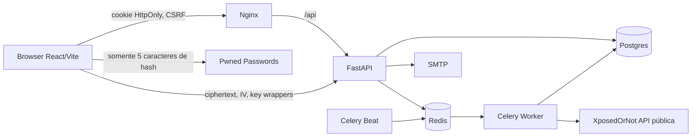

# Arquitetura do CoFree

## Visão geral

Frontend SPA **React + TypeScript + Vite + Tailwind CSS e CSS customizado**, servido por **Nginx** em contêiner próprio. Nginx encaminha `/api` ao **FastAPI**; o FastAPI aplica autenticação, validação, persistência **SQLAlchemy + PostgreSQL** e consultas à API gratuita XposedOrNot. **Redis** suporta limites distribuídos de taxa e a fila do **Celery Worker**; **Celery Beat** publica verificações agendadas. Em desenvolvimento, **Mailpit** recebe e-mails via SMTP. O navegador é a única entidade com acesso ao Vault descriptografado.

## Limites de confiança

- **Fronteira navegador → API:** sessão autenticada, cookies, CSRF, validação e controles de propriedade.
- **Fronteira API → PostgreSQL:** somente consultas ORM parametrizadas; dados vinculados a `user_id`.
- **Fronteira API/worker → terceiros:** requisições HTTPS sem API Key, cota compartilhada por Redis e falhas explicitamente classificadas como indisponibilidade.
- **Fronteira Vault:** material de chave e credenciais em claro ficam no processo do navegador. O servidor recebe somente ciphertext e envelopes cifrados; não verifica a senha mestra.

## Estrutura

- `app/api/auth.py`: cadastro, verificação de e-mail, recuperação, sessões e conta.
- `app/api/monitoring.py`: endereços, consultas, dashboard e notificações.
- `app/api/vault.py`: armazenamento opaco de metadados criptográficos e itens cifrados.
- `app/security.py`, `app/dependencies.py`: hash Argon2id, sessões, CSRF, autorização.
- `app/providers/xposedornot.py`, `app/services.py`, `app/tasks.py`: adaptador XposedOrNot sem API Key, regras de monitoramento e Celery.
- `frontend/src/crypto/vault.ts`: derivação Argon2id, AES-GCM, recuperação e Pwned Passwords.
- `frontend/src/App.tsx`: interface por rotas e componentes reutilizados.

## Padrões utilizados e limitações

Serviços e modelos desacoplados das rotas quando relevante, migrations Alembic, configuração via ambiente, eventos de auditoria sem conteúdo sensível. A camada de repositório está implementada diretamente com SQLAlchemy em serviços e rotas; não há abstração `repositories/` separada para todos os recursos. Testes E2E e Docker foram preparados, mas não executados neste ambiente. Ainda não existe observabilidade/telemetria de produção, integração automatizada de fila SMTP independente ou auditoria externa de criptografia.

## Personalização de monitoramento (2026-11)

O modelo `MonitoringPreference` armazena apenas ativações e intervalos por usuário. O Alembic migra para a tabela `monitoring_preferences`. O Celery agendador filtra e-mails habilitados e consulta XposedOrNot respeitando o limitador Redis. A interface de senhas é um componente **client-only**: o Vault criptografado permanece inacessível ao backend, e a frequência de senhas se aplica somente quando o cofre está desbloqueado e a aba ativa. O Pwned Passwords recebe um prefixo SHA-1 (5 caracteres), não recebe a senha ou o digest completo. Resultados resumidos ficam localmente no navegador, não no banco.
