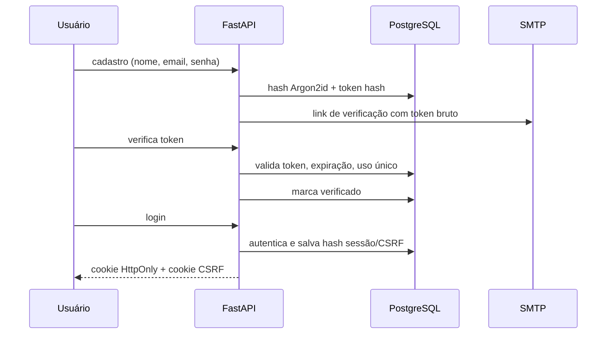
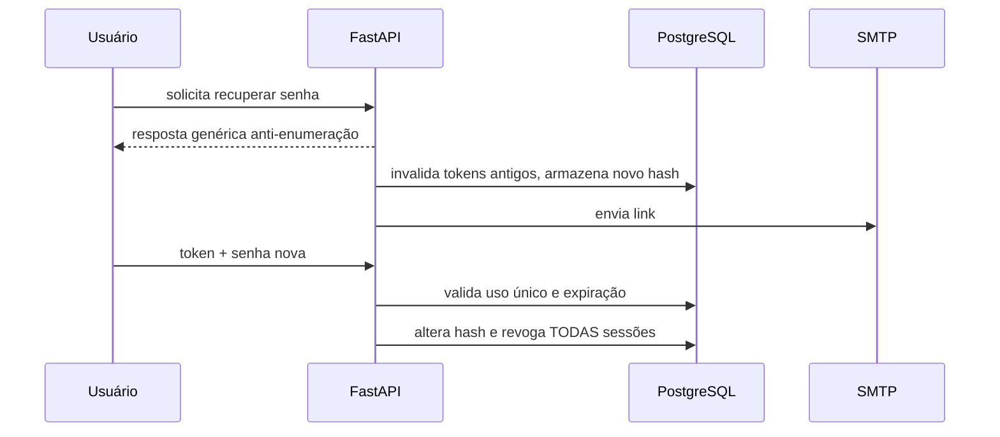

# Autenticação e gestão de sessões

## Fluxos

Sessões são identificadas por valores aleatórios. Backend guarda apenas o hash SHA-256 do token; cookies contêm o token bruto, `HttpOnly` para sessão e acessível a JS somente para CSRF. Expiração: 7 dias. `last_seen` atualizado com intervalo mínimo de 1 minuto por requisição autenticada. A verificação de sessão ocorre em todo endpoint protegido; um JWT isolado sem consulta ao backend não é utilizado.

**Revogação:** `DELETE /api/auth/sessions/{id}` termina a sessão identificada; `DELETE /api/auth/sessions?others=true` encerra as demais. Alteração ou recuperação da senha invalida todas as sessões.

**CSRF:** a autenticação usa cookies e o método `current_session` exige token de cabeçalho em mutações. Testes negativos verificam ausência e valores incorretos.

**Limitações:** ainda não há MFA, rotação periódica automática de token no mesmo dispositivo, fingerprint confiável ou geolocalização. Tais mecanismos não são afirmados como concluídos.
