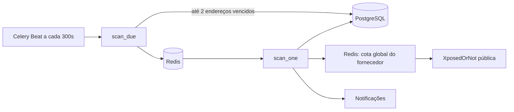

# Execução assíncrona — Celery/Redis

O `backend/app/tasks.py` define Celery, `scan_due` e `scan_one`. O broker e backend de resultados utilizam Redis; Worker e Beat são serviços independentes no Docker Compose.

O `scan_due` seleciona **até 2** endereços por execução, marca-os `queued` e posterga `next_check` por 10 minutos enquanto o Worker processa. O provedor exige cota: a janela móvel global é compartilhada pelos workers via script Lua atômico em Redis (1/s, 24/h, 95/dia). Em excesso ou falha, o scan fica `unavailable` e a próxima tentativa é reagendada, respeitando `Retry-After` quando fornecido ou um atraso padrão. A execução nunca transforma um erro em `clear`.

O `scan_one` chama `scan_monitor`, persiste `Check` e insere `Exposure` de forma idempotente (constraint `UNIQUE(monitor_id, breach_name)`). Novos nomes criam notificações; nomes já registrados não criam duplicatas. O envio SMTP falho não apaga notificações internas.

**Operação:** `docker compose logs -f worker beat redis`; `docker compose restart worker beat`. Verificar estados `queued` e `unavailable` no dashboard/histórico. Em `429`, evite insistência manual e aguarde nova janela.

**Pendências:** execução real em contêiner não comprovada neste ambiente; faltam teste end-to-end de execução agendada, lock distribuído por monitor, política de retry exponencial com jitter, métricas operacionais e gestão de backlog. O limite da API gratuita não garante monitoramento a cada 24h se houver volume elevado.

## Agendamento personalizado (novembro/2026)

Cada usuário pode ativar/desativar verificações de e-mails e selecionar `1h`, `24h`, `7d` ou `30d`, persistidos em `monitoring_preferences`. O `scan_due` ignora usuários desabilitados. A frequência é meta e sofre atrasos para respeitar a cota Redis/XposedOrNot. **Senhas não são verificadas pelo Celery**; a consulta é client-side com Vault desbloqueado, para não expor dados confidenciais.

O Compose substitui o healthcheck HTTP herdado do backend no `worker` por `celery inspect ping` e desabilita esse healthcheck no `beat`; acompanhe o processo e os logs do Beat separadamente.
