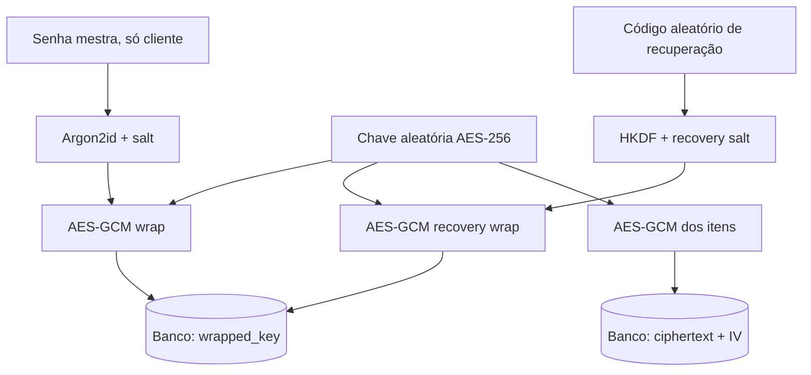

# Criptografia do Vault

O servidor **não possui acesso às senhas, nomes de serviços, logins e notas em claro**. O navegador usa `libsodium-wrappers-sumo` para Argon2id e Web Crypto nativo para AES-256-GCM.

## Criação

1. Navegador gera `salt` de 16 bytes e derivação Argon2id da senha mestra (3 iterações, memória 64 MiB, 32 bytes).
2. Navegador gera chave aleatória do Vault de 256 bits e a cifra sob a chave derivada (`wrapped_key`, AES-256-GCM).
3. Navegador gera código de recuperação aleatório de 256 bits, deriva via HKDF/SHA-256 + salt próprio e cifra a mesma chave do Vault (`recovery_wrapped_key`).
4. Backend recebe somente `salt`, parâmetros de derivação, envelopes cifrados e salt de recuperação.
5. Usuário recebe a chave de recuperação em exibição única. Não existe cópia do código no servidor.

## Operação

Cada criação/edição de item utiliza um IV aleatório de 96 bits gerado por `crypto.getRandomValues`; o conteúdo JSON é criptografado pelo Web Crypto com AAD vinculando versão, ID do usuário e ID do item, e enviado como ciphertext base64 + IV + ID público. No desbloqueio, o envelope é aberto no cliente e os itens são descriptografados somente na memória. A senha mestra não é enviada ao backend nem guardada no armazenamento persistente do browser. Há bloqueio após aproximadamente 10 minutos de inatividade da tela do Vault.

O padrão AES-GCM autentica a mensagem; mutações nos bytes cifrados fazem `decrypt` falhar. A vinculação por AAD impede que um ciphertext válido seja trocado silenciosamente de registro ou entre usuários. Ainda são necessários testes reais de recuperação, reencapsulamento e execução em múltiplos navegadores.

## Verificação de senhas expostas

Verificação Pwned Passwords só ocorre ao clicar no botão: cliente calcula SHA-1 localmente para compatibilidade com a API, envia apenas 5 caracteres hexadecimais a `api.pwnedpasswords.com/range/{prefix}`, compara os sufixos recebidos localmente e usa `Add-Padding:true`. A resposta "não encontrada" não garante força absoluta da senha.

## Observações

- O backend não tem material para recuperar dados, mesmo após redefinição da senha de acesso.
- Biblioteca libsodium e ambiente de browser precisam de revisão de segurança e testes de execução reais.
- Troca da senha mestra reencapsula a chave de dados, não recriptografa cada item; não deve ser descrita como rotação de chave de dados.
