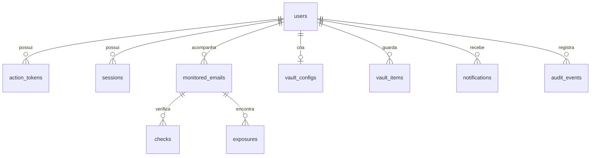

# Banco de dados e modelo relacional

Banco principal: **PostgreSQL 16** via SQLAlchemy 2, com migração inicial Alembic em `backend/migrations/versions/`. Chaves primárias UUID como string, índices de busca e FKs com `ondelete=CASCADE`. No ambiente de testes utiliza-se SQLite com foreign keys ativadas.

| Tabela | Propósito | Relações |
|---|---|---|
| `users` | identidade, hash Argon2id, verificação, preferência | raiz do usuário |
| `action_tokens` | hash de token e expiração (verify/reset) | FK `user_id` |
| `sessions` | hash de sessão/CSRF, expiração e revogação | FK `user_id` |
| `monitored_emails` | endereços e status da consulta | FK `user_id`, UNIQUE(user_id,email) |
| `checks` | histórico de verificação | FK `monitor_id` |
| `exposures` | vazamentos conhecidos por endereço | FK `monitor_id`, UNIQUE(monitor_id,breach_name) |
| `vault_configs` | salt e envelopes cifrados, sem chave em claro | FK `user_id` PK |
| `vault_items` | ciphertext + nonce/IV por item | FK `user_id` |
| `notifications` | alertas internos, situação de leitura | FK `user_id` |
| `audit_events` | tipo de evento e timestamp sem segredos | FK `user_id` |

**Integridade:** `UNIQUE` impede duplicidade de e-mails de um mesmo usuário e nomes duplicados de exposições do mesmo endereço. Rotas filtram por proprietário antes de acessar, editar ou excluir. FKs aplicam exclusão cascata de dados da conta (testada no SQLite).

**Dados sensíveis:** `password_hash` contém apenas hash; `vault_items.ciphertext` e `vault_configs.*wrapped_key` armazenam apenas material cifrado. `notifications` não inclui credenciais. Endereços monitorados são dados pessoais e precisam de base legal, retenção e consentimento adequado para operação real.

**Retenção:** para esta versão, os dados permanecem até exclusão pelo usuário. Uma política operacional de retenção de logs/eventos e automação de eliminação programada ainda precisa ser implantada em produção.

## Migração 2026-11

A migração `af43b7d1c202_monitoring_preferences.py` cria `monitoring_preferences` com chave primária/estrangeira `user_id` e campos `email_enabled` (padrão `true`), `email_interval` (`24h`), `password_enabled` (`false`) e `password_interval` (`7d`). As quatro frequências aceitas são `1h`, `24h`, `7d` e `30d`. Dados pessoais de senha, hashes inteiros ou consultas de senhas **não** são adicionados ao banco. Valores agregados locais de análises do Vault podem ficar no `localStorage` deste navegador, não são sincronizados.
