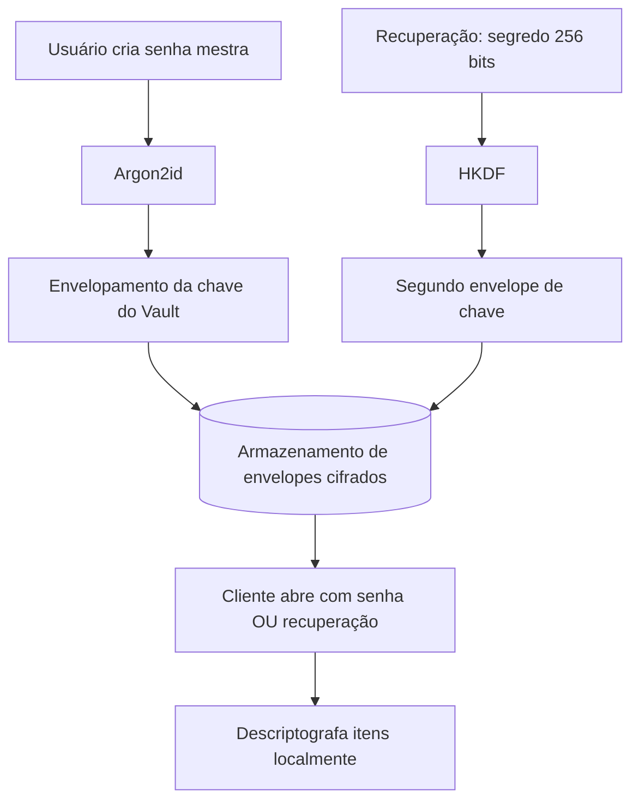

# Gerenciamento, recuperação e destruição de chaves

A chave mestra de **dados** é aleatória e gerada no navegador. A senha mestra cria uma **chave de envelopamento** Argon2id; o código de recuperação cria outra via HKDF. Ambas cifram a chave de dados com AES-GCM, e somente envelopes cifrados são gravados no banco.

**Recuperação:** no Vault bloqueado, selecione "Tenho uma chave de recuperação" e cole a chave de 256 bits mostrada na criação. O conteúdo será aberto no navegador; a chave jamais será enviada ao servidor. Se senha mestra e chave de recuperação forem perdidas, não há recuperação administrativa.

**Alteração de senha mestra:** em Configurações, informe a senha mestra atual e uma nova senha. O navegador abre a chave de dados, gera novo salt de Argon2id e faz novo envelopamento. **Atenção:** a opção de código de recuperação na UI atual rederiva o envelope com o código fornecido; isso não invalida uma cópia anterior do mesmo código. Não existe fluxo completo de rotação/revogação da recuperação com novo código aleatório e confirmação de armazenamento. Essas funcionalidades permanecem pendentes para segurança de produção.

**Dispositivos:** não há cadastro/revogação individual de dispositivos do Vault. O acesso à conta com código de recuperação ou senha mestra permite abrir os dados em outro navegador. Revogação de sessões da conta não destrói chaves já obtidas fora de banda.

**Destruição:** exclusão da conta remove ciphertext e envelopes do PostgreSQL ativo; backups seguem política operacional separada. Bloqueio do Vault zera a referência ao buffer em memória com `.fill(0)`, mas não garante limpeza física de todos os buffers internos de Web Crypto/JS. Não se deve prometer apagamento criptográfico imediato em todos os níveis do navegador.
